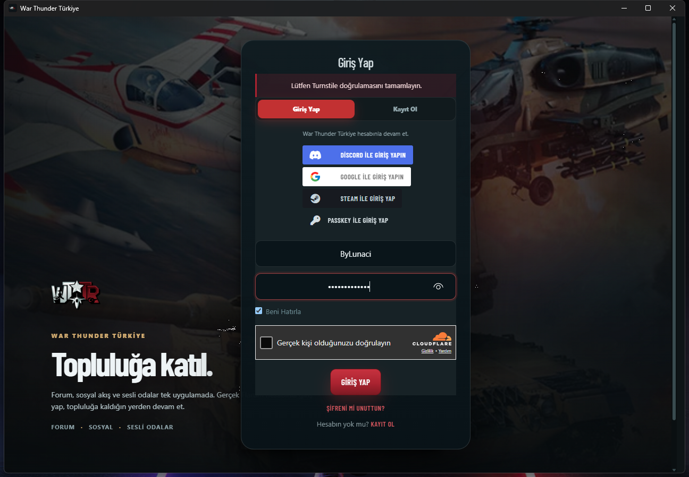

<p align="center">
  
</p>

<h1 align="center">War Thunder Türkiye APP</h1>

<p align="center">
  Rust + Tauri ile geliştirilmiş Windows masaüstü uygulaması.<br />
  Forum, blog ve sosyal alan tek pencerede; gerçek Flarum oturumu, global bas-konuş ve Windows bildirimleri.
</p>

<p align="center">
  <a href="https://github.com/cengizkemec/warthunder-turkiye-app/releases/latest">Son Sürüm</a> ·
  <a href="https://github.com/cengizkemec/warthunder-turkiye-app/releases/download/v0.2.3/WarThunderTurkiyeSetup-0.2.3.exe">Kurulum Dosyası</a> ·
  <a href="https://warthunder.tr">warthunder.tr</a>
</p>



## Hızlı bağlantılar

- **Uygulama deposu:** https://github.com/cengizkemec/warthunder-turkiye-app
- **Son sürüm:** https://github.com/cengizkemec/warthunder-turkiye-app/releases/latest
- **v0.2.3 kurulum dosyası:** https://github.com/cengizkemec/warthunder-turkiye-app/releases/download/v0.2.3/WarThunderTurkiyeSetup-0.2.3.exe
- **Köprü eklentisi:** özel/opsiyonel (depo gizli)
- **Site:** https://warthunder.tr

## Nedir?

War Thunder Türkiye APP, `warthunder.tr` sitesini native bir Windows uygulaması içinde kullanır. Siteyi yeniden yazmaz; mevcut Flarum oturumunu, forumu, blogu, sosyal akışı ve sesli odaları aynı WebView2 profilinde çalıştırır.

Bu proje **Flarum Social eklentisinden bağımsızdır**. Foruma kod, rota veya zorunlu eklenti eklemez. İsteğe bağlı `warthunder-desktop-bridge` eklentisi yalnızca oturum yedeği ve güncelleme manifesti sağlar.

## Özellikler

- **Login-first:** Giriş yapılmadan Forum, Blog ve Sosyal bölümleri açılmaz.
- **Gerçek Flarum giriş/kayıt formu:** Uygulama ana ekranında Flarum’un kendi giriş ve kayıt modalı görünür. Turnstile ve site güvenlik doğrulaması aynen çalışır.
- **Animasyonlu giriş ekranı:** Türkiye temalı arka plan, yavaş hareket eden görsel, ışık efekti ve modal geçiş animasyonu.
- **Oturum kalıcılığı:** “Beni hatırla” otomatik işaretlidir. Çıkış yapmadığın sürece uygulama yeniden açıldığında tekrar giriş istemez.
- **Çerez bildirimi gizleme:** Giriş sırasında çerez bildirimi gizlenir; formun üstüne binmez.
- **Forum üst menüsü:** Forum, Sosyal, Discord, Destek, İndir, Araçlar, TV ve Yasal bağlantıları uygulama içinde.
- **Son 10 forum konusu:** Dashboard’da forumun son açılan konuları.
- **Global bas-konuş:** Uygulama arka planda olsa bile çalışır. Caps Lock, harfler, sayılar, F tuşları, yön tuşları, medya tuşları ve daha fazlası atanabilir.
- **Anlık Windows bildirimleri:** Varsayılan olarak açık. Yeni Flarum bildirimleri Windows bildirimi olarak gösterilir; Ayarlar’dan test edilebilir.
- **Bildirim merkezi:** Dashboard’da son 8 Flarum bildirimi; okundu durumu, gönderen ve tarih. Bildirime tıklayınca ilgili konuya/notifications sayfasına gider.
- **Mikrofon testi:** Windows mikrofon izin akışını tetikleyen test düğmesi.
- **Güncelleme:** GitHub Releases ve `warthunder.tr` manifesti üzerinden sürüm kontrolü; sessiz kurulum ve otomatik yeniden açılış.
- **Tepsi:** Ana Sayfa, Forum, Blog, Sosyal, Yenile, Çıkış. “2. Monitöre Taşı” kaldırıldı.
- **Masaüstü kısayolu:** Kurulumda varsayılan olarak oluşturulur.
- **Uygulama ikonu:** `https://warthunder.tr/assets/pwa-icon-512x512-s8vyxeai.png`

## Son kullanıcı kurulumu

1. [Son sürüm kurulum dosyasını](https://github.com/cengizkemec/warthunder-turkiye-app/releases/latest) indir.
2. Kurulumu çalıştır. Windows SmartScreen/Norton uyarısı çıkarsa “Daha fazla bilgi → Yine de çalıştır” veya güvenlik yazılımında izin ver.
3. Kurulum tamamlandığında masaüstü kısayolu ve Başlat menüsü kısayolu oluşur.
4. Uygulamayı aç. Flarum giriş ekranı gelir; kullanıcı adı/şifreni gir.
5. Turnstile doğrulamasını tamamla (“Gerçek kişi olduğunuzu doğrulayın” kutucuğu çıkabilir).
6. **Giriş Yap**’a bas. Giriş başarılı olduğunda dashboard açılır.

> İlk girişten sonra “Beni hatırla” sayesinde oturum korunur. Çıkış yapmadığın sürece tekrar giriş istemez.

## Giriş akışı

Uygulamanın ana ekranı, `warthunder.tr` sayfasının üzerine yerleştirilmiş animasyonlu bir arka plan ve **gerçek Flarum giriş/kayıt modalıdır**.

- Giriş ve kayıt sekmeleri Flarum’un kendi modallarını açar.
- Turnstile ve varsa diğer güvenlik adımları site tarafından yönetilir; uygulama CAPTCHA’yı atlamaz.
- Çerez bildirimi giriş sırasında gizlenir.
- Giriş başarılı olduğunda sayfa oturumu okunur, uygulama dashboard’a geçer ve site penceresi gizlenir.
- Çıkış yapıldığında tekrar Flarum giriş ekranına dönülür.
- Discord, Google, Steam ve passkey girişleri Flarum modalındaki düğmelerden kullanılabilir.

Oturum, WebView2 profilinde saklanır. Profil konumu:

```text
%LOCALAPPDATA%\tr.warthunder.desktop\EBWebView
```

Ayarlar:

```text
%LOCALAPPDATA%\tr.warthunder.desktop\settings.json
```

## Anlık bildirimler

- Varsayılan olarak **açıktır**.
- Yeni Flarum bildirimi geldiğinde Windows bildirimi gösterilir.
- Dashboard’daki hesap rozetinde okunmamış bildirim sayısı görünür.
- **Ayarlar → Bildirimler → Bildirim testi** ile Windows bildiriminin çalışıp çalışmadığını test edebilirsin.
- Windows bildirimleri kapalıysa: **Ayarlar → Sistem → Bildirimler** bölümünden “War Thunder Türkiye” / WebView2 bildirimlerine izin ver.
- Odak Yardımı (Focus Assist) açıksa bildirimler sessize alınabilir.

## Mikrofon

- **Ayarlar → Mikrofonu test et** düğmesi mikrofon izni isteğini tetikler.
- Ardından **Windows ayarlarını aç** ile `ms-settings:privacy-microphone` sayfasına gidilir.
- Windows, WebView2 tabanlı uygulamalarda mikrofon iznini **WebView2** adıyla gösterebilir. Bu, WebView2’nin ayrı süreç mimarisinden kaynaklanır; izin verildiğinde mikrofon uygulama içinde çalışır.
- Windows’ta “Masaüstü uygulamalarının mikrofonunuza erişmesine izin ver” seçeneği açık olmalıdır.
- Social sesli odalarda bas-konuş açık olmalıdır.

## Bas-konuş

- Varsayılan tuş: **Alt**.
- **Ayarlar → Bas-konuş tuşu → butona tıkla → istediğin tuşa bas → Kaydet.**
- Desteklenen örnekler: Caps Lock, A-Z, 0-9, F1-F24, Space, Tab, Enter, ok tuşları, Home/End, Page Up/Down, Insert/Delete, noktalama işaretleri, medya ve ses tuşları.
- Bas-konuş global çalışır; uygulama arka planda veya tepside olsa bile mikrofonu açar.
- Masaüstü uygulamasındaki tuş yalnızca global kısayoldur. Social tarafındaki bas-konuş ayarından bağımsızdır; siteye `WTTRDesktop.setPTT` üzerinden bildirilir.

## Güncelleme

Uygulama iki kaynaktan güncelleme kontrol eder:

1. **GitHub Releases:** `cengizkemec/warthunder-turkiye-app`
2. **warthunder.tr manifesti:** `https://warthunder.tr/api/desktop/config`

Yeni sürüm bulunduğunda dashboard’un üstünde güncelleme şeridi görünür. **Güncelle** düğmesi kurulum dosyasını indirir, sessiz kurulumu başlatır ve uygulamayı yeniden açar.

## Tepsi ve pencere

- Sol tık: Ana ekran.
- Tepsi menüsü: Ana Sayfa, Forum, Blog, Sosyal, Yenile, Çıkış.
- Kapatma düğmesi varsayılan olarak uygulamayı tepsiye küçültür.
- “2. Monitöre Taşı” seçeneği kaldırılmıştır.
- Tek örnek kilidi vardır; uygulama ikinci kez açılırsa mevcut pencere öne gelir.

## Mimari

- `dist/` — yerel dashboard, ayarlar ve giriş ekranı varlıkları.
- `src-tauri/` — Rust tarafı: pencereler, tepsi, global bas-konuş, ayarlar, bildirimler, oturum köprüsü ve güncelleme kontrolü.
- Site içeriği ayrı bir WebView2 penceresinde `https://warthunder.tr` üzerinden açılır.
- Yerel dashboard ile site penceresi ayrıdır; site içeriğinin Tauri IPC’ye erişimi yoktur.
- Oturum köprüsü: Site sayfasına enjekte edilen küçük bir okuyucu, oturum durumunu `https://warthunder.tr/__wttr_desktop/session` adresine bildirir; Rust bu yönlendirmeyi yakalar, siteye göndermeden iptal eder ve dashboard’u günceller.
- `warthunder-desktop-bridge` eklentisi `/api/desktop/session` yedeğini ve güncelleme manifestini sağlar.

## WebView2, Chromium ve Gecko

WebView2, Windows’ta `msedgewebview2.exe` adlı ayrı sandbox süreçlerinde çalışır. Bu süreçler Görev Yöneticisi’nde “WebView2” olarak görünür. Bu bir hata değildir; güvenlik ve kararlılık için tasarlanmıştır.

- WebView2’yi ana uygulama sürecine gömme desteklenen bir seçenek değildir.
- Chromium (CEF/Electron) ve Gecko da çok süreçli çalışır; “tek süreç” elde edilmez.
- Electron/CEF’e geçmek uygulamayı yeniden yazmak, kurulum boyutunu büyütmek ve WebView2 bağımlılığını kaldırmak demektir. Mikrofon izninin uygulama adıyla görünmesi zorunluysa ileride ayrı bir Electron/CEF sürümü değerlendirilebilir.
- Gecko’yu Windows masaüstü uygulamasına gömmek pratik ve bakımlı bir yol değildir.

## Kod imzalama

Windows SmartScreen, Norton ve Smart App Control için **güvenilir bir kod imzalama sertifikası** gerekir. Depoda sertifika veya özel anahtar tutulmaz.

### PFX dosyası ile

```powershell
$env:WTTR_SIGN_PFX = 'C:\path\to\certificate.pfx'
$env:WTTR_SIGN_PASSWORD = 'pfx-password'
powershell -ExecutionPolicy Bypass -File scripts\sign.ps1
```

### Sertifika mağazası / EV token ile

```powershell
$env:WTTR_SIGN_THUMBPRINT = 'CERTIFICATE_THUMBPRINT'
powershell -ExecutionPolicy Bypass -File scripts\sign.ps1
```

Script önce uygulama exe’sini imzalar, sonra Inno Setup paketini üretir ve paketi imzalar.

> Self-signed sertifika yalnızca yerel testte kullanılabilir; başka bilgisayarlarda SmartScreen/Norton tarafından güvenilir sayılmaz. Dağıtım için OV veya EV kod imzalama sertifikası gerekir.

## Geliştirme

```powershell
npm install
npm run dev
```

### Windows kurulum paketi

```powershell
npm install
npm run tauri build
& "C:\Program Files\Inno Setup 7\ISCC.exe" installer\warthunder-tr.iss
```

Çıktı:

```text
dist-installer\WarThunderTurkiyeSetup-0.2.3.exe
```

Tauri ayrıca NSIS paketi üretir:

```text
src-tauri\target\release\bundle\nsis\
```

### Gereksinimler

- Windows 10/11 x64
- Microsoft Edge WebView2 Runtime (Windows 10/11’de genellikle kuruludur)
- Rust, Node.js 20+, Visual Studio Build Tools
- Inno Setup 7 (kurulum paketi için)

## Sorun giderme

### “Oturum kontrol ediliyor” ekranında kalıyor

- İnternet bağlantısını ve `https://warthunder.tr` erişimini kontrol et.
- Norton 360, Smart App Control veya benzeri güvenlik yazılımları imzasız yeni derlemeyi ilk açılışta karantinaya alabilir. Uygulamaya izin ver, ardından **Tekrar dene** düğmesine bas.
- Kurulumdan sonra uygulamayı bir kez normal olarak açıp siteye erişebildiğini doğrula.

### Giriş yaparken Turnstile / çerez bildirimi

Giriş penceresinde Turnstile etkileşimli çıkabilir. Doğrulamayı tamamlayıp **Giriş Yap**’a bas. Çerez bildirimi giriş sırasında gizlenir; giriş sonrası siteyi kullanırken yeniden görünebilir.

### Görev Yöneticisi’nde WebView2 süreçleri

WebView2, `msedgewebview2.exe` adlı ayrı sandbox süreçlerinde çalışır. “WebView2” olarak görünmesi normaldir; bu süreçler uygulamanın parçasıdır. Ana sürece gömme desteklenmez.

### Mikrofon Windows’ta WebView2 olarak görünüyor

WebView2 tabanlı uygulamalarda mikrofon izni WebView2 sürecine bağlıdır; Windows bunu “WebView2” olarak listeleyebilir. **Mikrofonu test et** ile izin isteğini tetikle, Windows mikrofon gizlilik ayarlarından izin ver. İzin verildiğinde mikrofon çalışır.

### Bas-konuş çalışmıyor

- Social sesli oda ayarlarında bas-konuşun açık olduğundan emin ol.
- Uygulama Ayarlar ekranından farklı bir tuş atayıp tekrar dene.
- Mikrofon izninin Windows gizlilik ayarlarında açık olduğunu kontrol et.

### Güvenlik yazılımı uygulamayı siliyor veya engelliyor

İmzasız release dosyaları Norton/Smart App Control tarafından engellenebilir. Dağıtım için kod imzalama sertifikası kullanılması önerilir. Test sırasında uygulama klasörünü güvenlik yazılımının istisna listesine ekle.

## Yol haritası

- Güvenilir kod imzalama sertifikası ile imzalı kurulum
- Bildirim tıklamasında ilgili konuya gitme
- Özel ses cihazı seçimi
- Maç/oyun durumu entegrasyonu
- İsteğe bağlı Electron/CEF tabanlı alternatif paket

## Lisans

MIT
